<p align="center">
  <picture>
    <source media="(prefers-color-scheme: dark)" srcset="docs/assets/banner-dark.svg">
    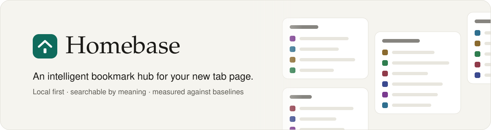
  </picture>
</p>

<p align="center">
  <a href="https://github.com/zac-knight/Homebase/actions/workflows/ci.yml"></a>
  
  
  
  
</p>

<p align="center">
  <a href="#quick-start">Quick start</a> ·
  <a href="#features">Features</a> ·
  <a href="#how-it-fits-together">Architecture</a> ·
  <a href="docs/evaluation.md">Evaluation</a> ·
  <a href="docs/status.md">Status</a> ·
  <a href="docs/threat-model.md">Privacy</a>
</p>

<br>

Homebase replaces Chrome's new tab page with a clean, searchable home for your bookmarks: your
folders as tabs, your favourites one click away, a to-do list for the day and slow waves drifting
along the bottom. An optional server adds search by meaning and answers drawn only from what you
have saved.

It works fully offline. Nothing leaves your browser unless you turn sync on.

<p align="center">
  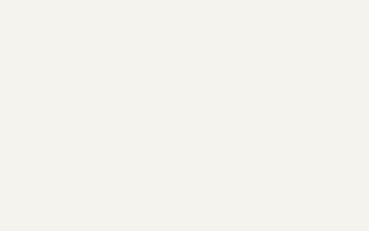
</p>

<p align="center">
  <picture>
    <source media="(prefers-color-scheme: dark)" srcset="docs/assets/screenshots/home-dark.png">
    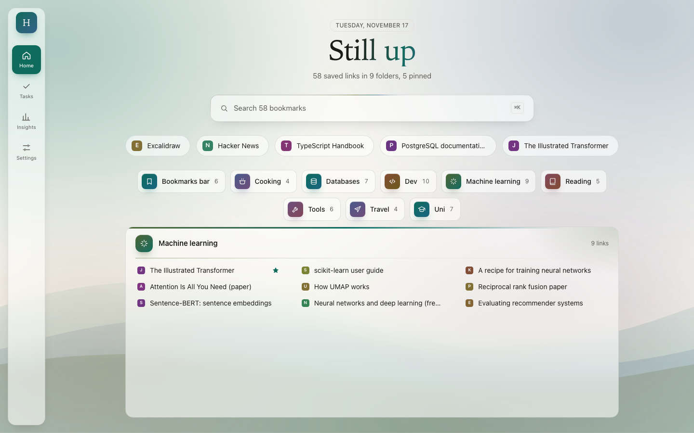
  </picture>
</p>

<table>
  <tr>
    <td width="50%">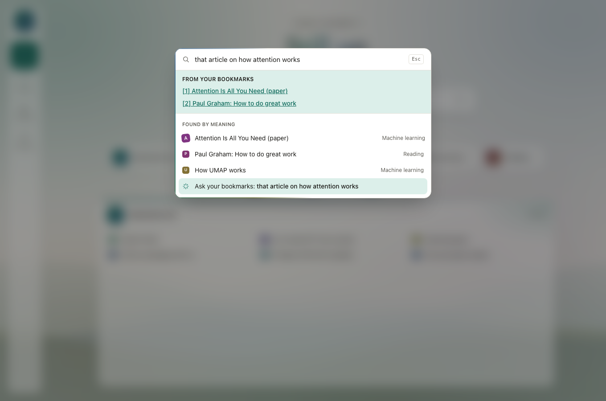</td>
    <td width="50%">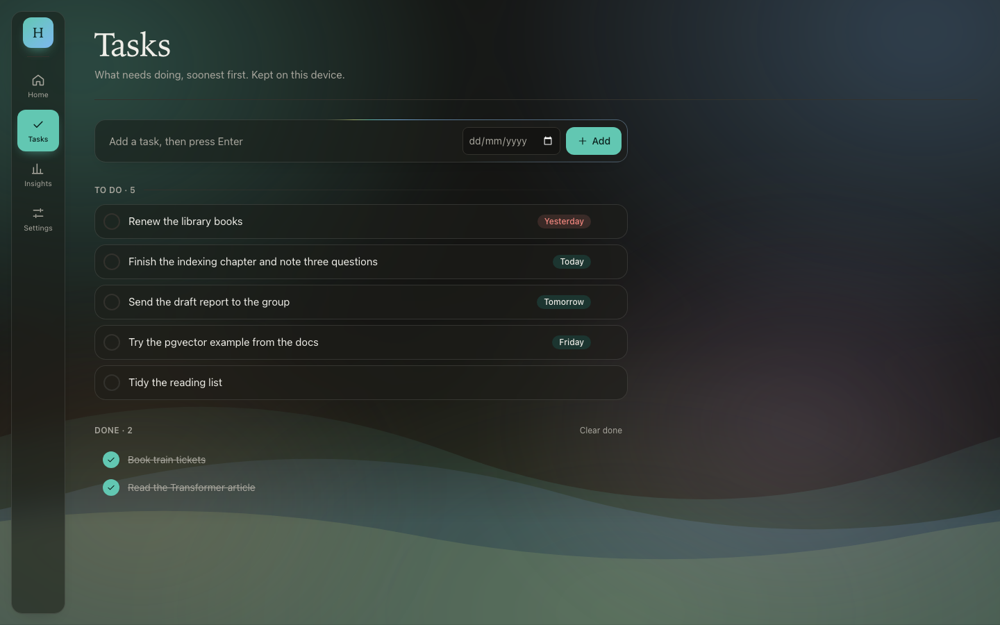</td>
  </tr>
  <tr>
    <td align="center"><sub><b>Search and grounded answers</b><br>Every line cites the bookmark it came from</sub></td>
    <td align="center"><sub><b>Tasks</b><br>Soonest due first, overdue ones flagged, kept on your device</sub></td>
  </tr>
  <tr>
    <td colspan="2" align="center">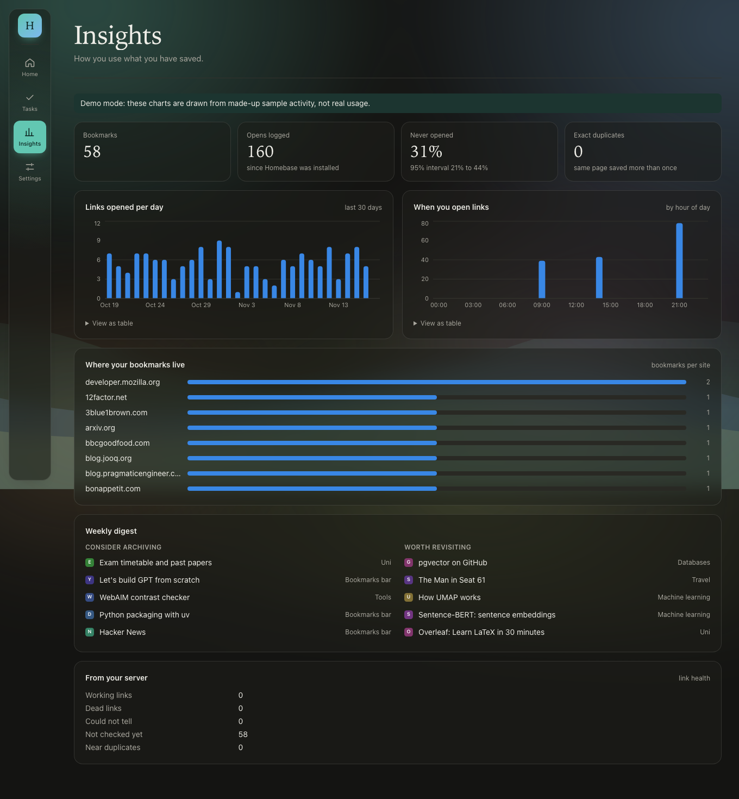</td>
  </tr>
  <tr>
    <td colspan="2" align="center"><sub><b>Insights</b><br>Usage charts, intervals instead of bare averages, a weekly digest, link health when synced</sub></td>
  </tr>
</table>

### Make it yours

Seventeen colour themes in light and dark, any accent colour, eight backgrounds (including your
own picture) with optional animated waves, glass, solid or outline cards, five typefaces, three
corner styles, adjustable spacing, eight one-click looks, and animations you can turn up, down or
off.

<table>
  <tr>
    <td width="33%">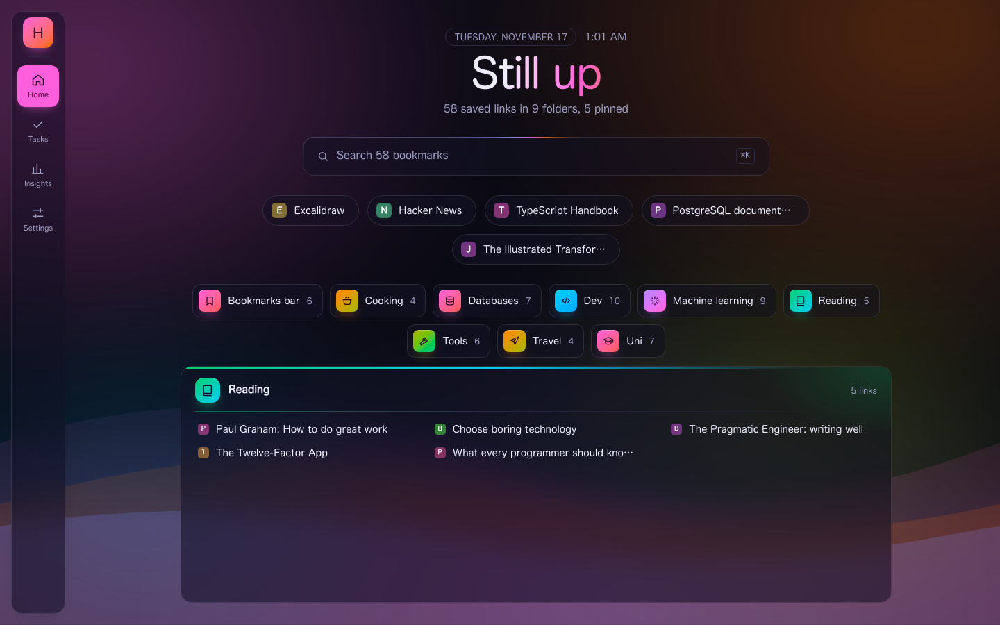</td>
    <td width="33%">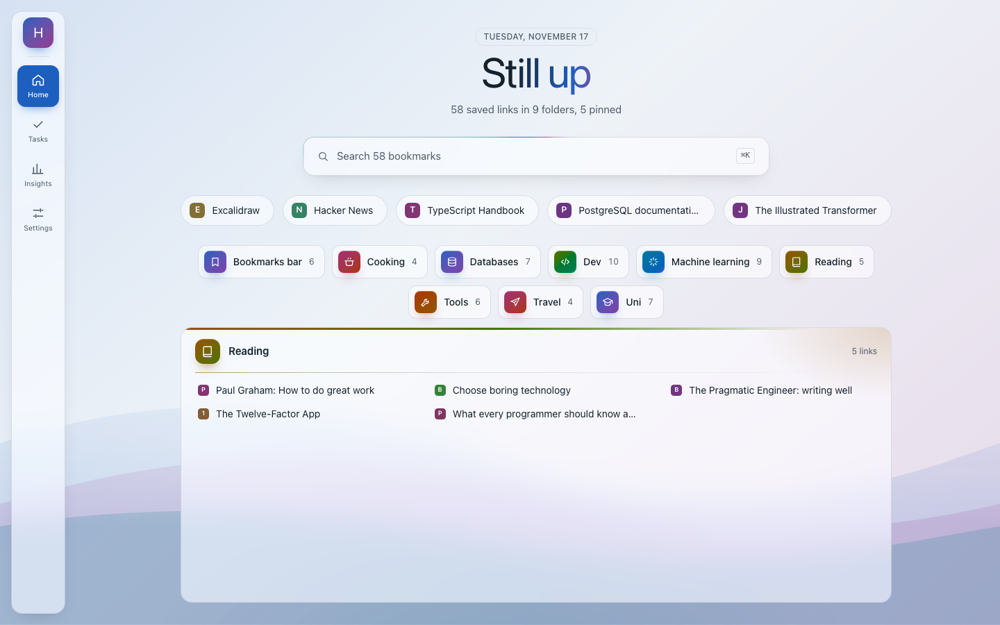</td>
    <td width="33%">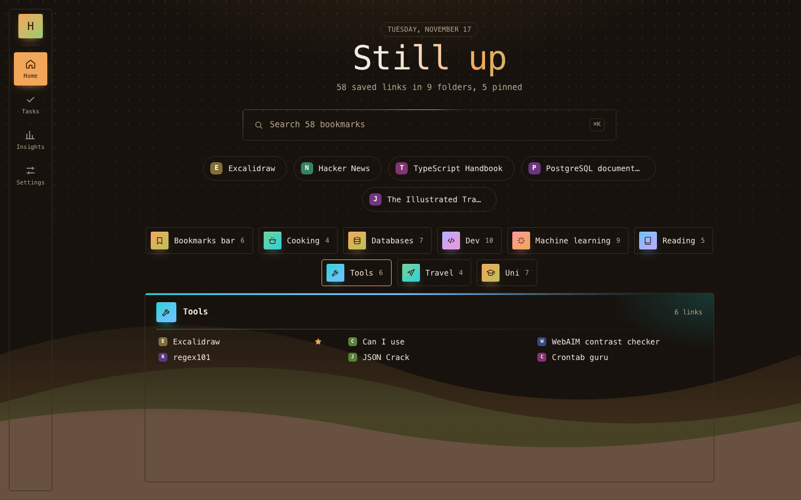</td>
  </tr>
  <tr>
    <td align="center"><sub>Neon · aurora · glass · clock</sub></td>
    <td align="center"><sub>Ocean · gradient · glass</sub></td>
    <td align="center"><sub>Sunset · dots · outline · mono · compact</sub></td>
  </tr>
  <tr>
    <td width="33%">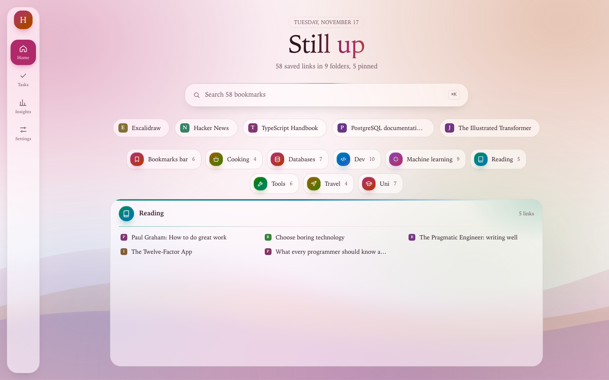</td>
    <td width="33%">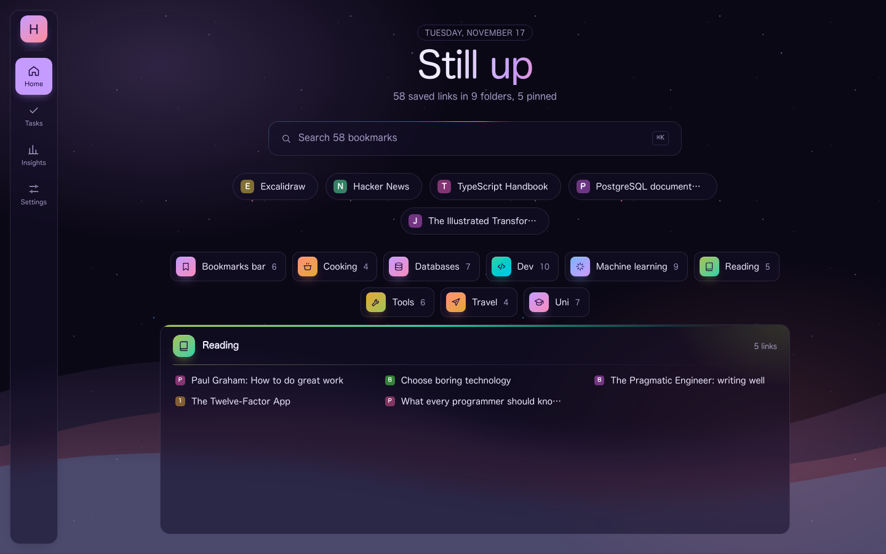</td>
    <td width="33%">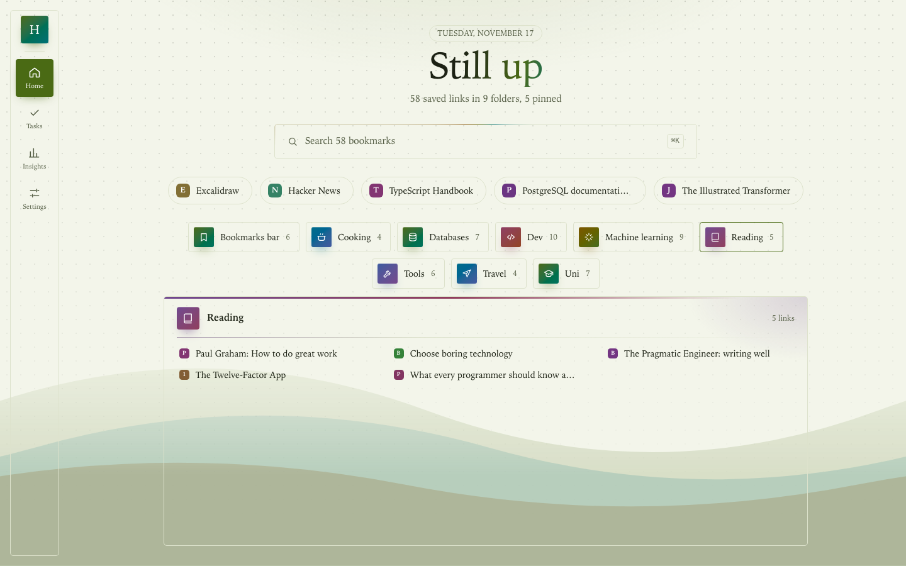</td>
  </tr>
  <tr>
    <td align="center"><sub>Blossom · aurora · glass · editorial</sub></td>
    <td align="center"><sub>Stargazer · stars · glass · rounded</sub></td>
    <td align="center"><sub>Tea house · dots · outline · sharp</sub></td>
  </tr>
</table>

## Quick start

**Extension only** (no server needed)

```bash
make setup build        # or: cd extension && npm install && npm run build
```

Open `chrome://extensions`, turn on **Developer mode**, choose **Load unpacked** and pick
`extension/dist`. Open a new tab.

No install? `make dev` serves the same page in a normal browser tab with a sample library.

**With the server**

```bash
make api                # SQLite, development sign in, http://localhost:8000/docs
```

Then in the extension: **Settings → Sync with a Homebase server**, and sign in. For PostgreSQL
with pgvector, run `docker compose up --build` instead.

## Features

<table>
  <tr>
    <th width="33%">In the browser</th>
    <th width="33%">With the server</th>
    <th width="33%">Under your control</th>
  </tr>
  <tr valign="top">
    <td>
      <b>Folder tabs</b> with the links of the open folder below, pinned favourites, drag and drop, and one-click remove with undo<br><br>
      <b>Tasks</b>: a to-do list with due dates, kept on your device<br><br>
      <b>Command palette</b> on <kbd>⌘K</kbd>, <kbd>Ctrl K</kbd> or <kbd>/</kbd>, tolerant of typos<br><br>
      <b>Looks</b>: themes, backgrounds, animated waves, card styles, typefaces and animations<br><br>
      <b>Insights</b> on what you use and ignore, including exact duplicates<br><br>
      <b>One screen</b>: the home page fits the window, so there is nothing to scroll
    </td>
    <td>
      <b>Search by meaning</b>: embeddings and BM25, fused by rank<br><br>
      <b>Ask your bookmarks</b>: quoted answers with sources, or an honest “nothing relevant”<br><br>
      <b>Link health</b>: finds dead links, shown in Insights<br><br>
      <b>Suggested folders and topic groups</b> from clustering, available from the API (the extension no longer has a page for them)
    </td>
    <td>
      <b>Local first</b>: sync is off until you turn it on<br><br>
      <b>Minimal permissions</b>: page reading, history and identity are requested only when used<br><br>
      <b>Export everything</b> in one click<br><br>
      <b>Delete everything</b> in one click, vectors included
    </td>
  </tr>
</table>

## How it fits together

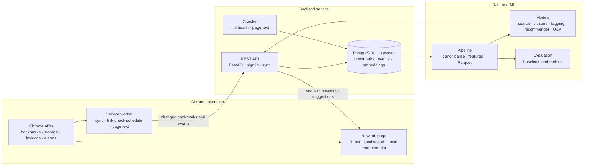

## Repository map

```
Homebase
├── extension/          Chrome extension (TypeScript, React, Vite, Tailwind)
│   ├── src/lib/          search, recommender, stats, sync, themes, the one chrome.* wrapper
│   ├── src/components/   home view, search palette, Tasks, Insights, Settings, Appearance, Waves
│   ├── src/background/   Manifest V3 service worker
│   └── e2e/              Playwright: UI, accessibility, real extension, live server
├── backend/            API and ML (Python, FastAPI)
│   ├── app/api/          one router per area: login, sync, search, organise, insights, jobs, account
│   ├── app/ml/           embeddings, BM25 + rank fusion, clustering, tagging, recommender, Q&A
│   ├── app/pipeline/     URL cleaning, feature engineering, statistics
│   ├── scripts/          evaluate.py, export_parquet.py
│   └── tests/
├── analysis/           Reproducible usage notebook over the Parquet export
├── sample-data/        Made-up bookmarks and labelled queries, safe to publish
├── docs/               Evaluation, status, design decisions, threat model
└── Makefile            setup · dev · api · build · lint · test · e2e · eval · check
```

Your own exports go in `data/`, which is git-ignored along with secrets, local databases and
build output. See [`.gitignore`](.gitignore).

## Status

> [!NOTE]
> The extension, API, evaluation and analysis all run and are covered by tests (20 unit, 36 API,
> 37 browser). **PostgreSQL with pgvector, Docker, the CI workflow, the Fly.io deploy and Google
> sign in are written but have not been run yet**: development so far used SQLite and an
> email-only sign in. Full list in [docs/status.md](docs/status.md).

Evaluation numbers are from a small demo dataset and should be read as a smoke test. On it,
hybrid search beat keyword search, but plain vector search beat both.
Details in [docs/evaluation.md](docs/evaluation.md).

## Documentation

| | |
| --- | --- |
| [Evaluation](docs/evaluation.md) | Every ML feature against its baseline, with caveats |
| [Status](docs/status.md) | What is verified, what is untested, what is not built |
| [Design decisions](docs/decisions.md) | The trade-offs worth explaining |
| [Threat model](docs/threat-model.md) | What data exists, where it lives, who can see it |
| [Extension](extension/README.md) · [Backend](backend/README.md) | Working on each half |
